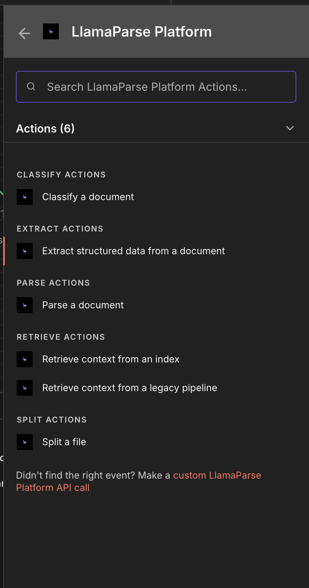
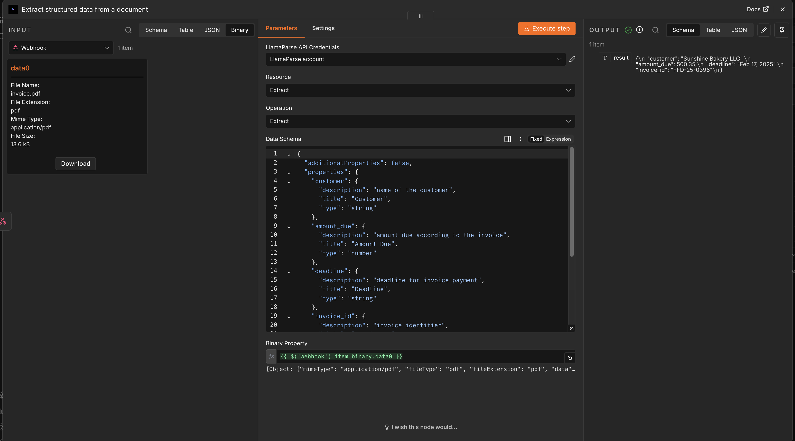

# Extract Setup in n8n

## Setup

Select the 'Extract structured data from a document' action from the LlamaParse Platform node:



When setting up the action, choose a **Configuration Mode**:

- **Schema** — paste an inline JSON schema that the extracted data should follow
- **Configuration ID** — use a saved LlamaExtract configuration from the LlamaCloud dashboard

Then provide the file as binary data or as a File ID from the "Upload a File" action:



As for Parse, you can also set the node to receive inputs from other nodes, such as a webhook.

## Options

Under **Options** you can enable:

| Option | Modes | Effect |
| --- | --- | --- |
| **Cite Sources** | Schema only | Sets `cite_sources` on the inline configuration so each field includes page, bounding box, and matching text |
| **Confidence Scores** | Schema only | Sets `confidence_scores` so each field includes a 0–1 confidence value |
| **Include Extraction Metadata** | Schema and Configuration ID | Fetches `extract_metadata` via `expand=extract_metadata` and adds it to the node output |

In **Configuration ID** mode, citations and confidence scores come from the saved configuration in the LlamaCloud dashboard — those Options are hidden because the API does not accept inline `configuration` together with `configuration_id`. Enable **Include Extraction Metadata** to surface that metadata in n8n.

Enabling **Cite Sources** or **Confidence Scores** also requests extraction metadata automatically (same as turning on Include Extraction Metadata), so you do not pay for citations/scores without receiving them.

### How citations and confidence reach the output

LlamaExtract needs **both** steps; one alone is not enough:

1. **At job creation** — set `cite_sources` and/or `confidence_scores` on the configuration (Schema Options, or the equivalent switches on a saved Configuration ID).
2. **At job read** — call `GET /api/v2/extract/{id}?expand=extract_metadata`.

Verified against the live API: with `expand=extract_metadata` but **without** those flags, the response still includes `extract_metadata`, but `field_metadata.document_metadata` is `{}`. With both flags set to `true` and expand, each field can include `confidence`, `extraction_confidence`, and `citation[]` (`page`, `matching_text`, `bounding_boxes`, `page_dimensions`).

On package **6.7.2** (before this change), the Extract action always returned only `{ result }`, so `extract_result`, `extract_metadata`, and `job_id` were never available in n8n even when a saved configuration had citations enabled.

### Default output (unchanged)

```json
{
  "result": "{\n  \"company_name\": \"Acme\",\n  \"total\": 1200\n}"
}
```

### Output with extraction metadata

```json
{
  "result": "{\n  \"company_name\": \"Acme\",\n  \"total\": 1200\n}",
  "extract_result": {
    "company_name": "Acme",
    "total": 1200
  },
  "extract_metadata": {
    "field_metadata": {
      "document_metadata": {
        "company_name": {
          "confidence": 0.97,
          "extraction_confidence": 0.97,
          "citation": [
            {
              "page": 1,
              "matching_text": "Acme Corp",
              "bounding_boxes": [{ "x": 50, "y": 80, "w": 120, "h": 18 }],
              "page_dimensions": { "width": 612, "height": 792 }
            }
          ]
        },
        "total": {
          "confidence": 0.62,
          "extraction_confidence": 0.62,
          "citation": [
            {
              "page": 2,
              "matching_text": "1,200.00",
              "bounding_boxes": [{ "x": 400, "y": 700, "w": 80, "h": 16 }],
              "page_dimensions": { "width": 612, "height": 792 }
            }
          ]
        }
      }
    }
  },
  "job_id": "ext-aaaaaaaa-bbbb-cccc-dddd-eeeeeeeeeeee"
}
```

Use low-confidence fields (for example `total` above) to route values to human review, and use `citation` (especially `bounding_boxes` + `page_dimensions`) to highlight where a value was found in the PDF.

**API note:** `matching_text` is sometimes the schema field path (for example `veicolo.targa`) instead of the verbatim document text. That comes from LlamaExtract, not from this node — prefer bounding boxes when you need reliable visual grounding.

---

### View Also:

- [Parse n8n setup](./llamaparse.md)
- [Index v2 n8n setup](./llamacloud_indexv2.md)
- [Classify n8n setup](./llamaclassify.md)
- [Split n8n setup](./llamasplit.md)
- [Setting up LlamaParse Platform nodes](./index.md)
- [Setup with Docker](./docker.md)
- [Back to top](#extract-setup-in-n8n)
